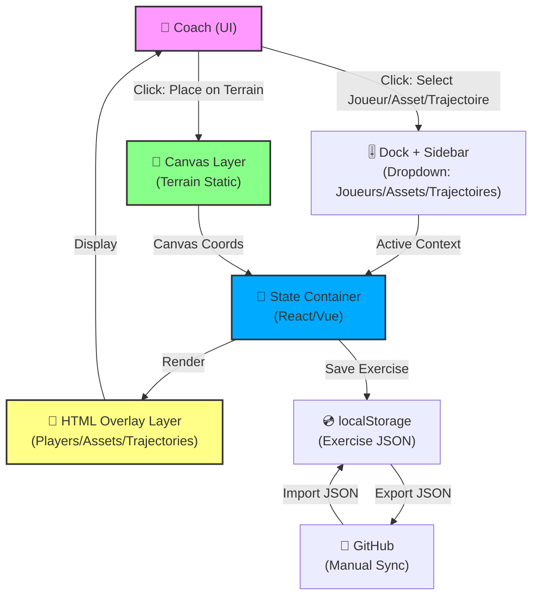
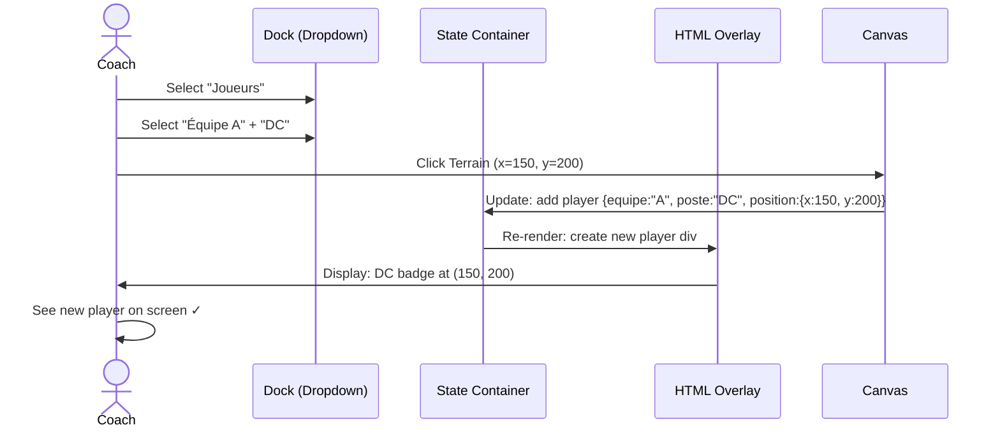
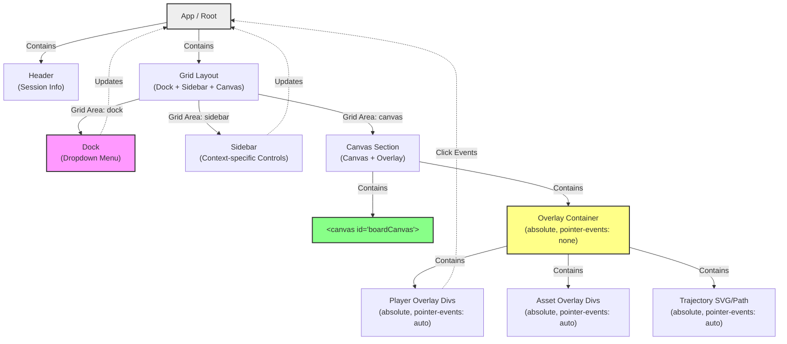

# Architecture Spine: Players, Assets & Trajectories Exercise Builder

## Design Paradigm

**Hybrid Rendering + State-Driven UI**

- **Terrain canvas** (static): renders court/field once, unchanged by exercise builder
- **HTML overlay layer** (dynamic): players, assets, trajectories as positioned DOM elements
- **Centralized state** (React/Vue component): { players, assets, trajectories } drives DOM
- **Event-driven interactions**: click terrain → calculate position → update state → re-render overlay

This paradigm separates **static context** (canvas) from **interactive elements** (HTML), simplifying hit detection, movement, and undo/redo (future). Re-rendering overlay is cheaper than canvas redraw.

---

## Architecture Decisions

### AD-1: Framework Choice (React or Vue)
**Binds:** Component hierarchy, state management pattern, build tooling  
**Prevents:** Vanilla JS state spaghetti; fragmented re-render logic  
**Rule:** React or Vue (decision deferred to implementation; both support this spine equally)  
**Rationale:** Either framework handles component state + event binding cleanly for player/asset/trajectory selection UI  
**[OPEN]** Final choice made at Sprint 1 (learning curve, team fit)

---

### AD-2: Dual-Layer Rendering (Canvas + HTML Overlay)
**Binds:** Interaction model, hit detection, performance strategy  
**Prevents:** Complex canvas drawing + redraw on every change  
**Rule:**
- **Layer 1 (Canvas):** Terrain rendering (court, lines, zones) — rendered once at session start
- **Layer 2 (HTML Overlay):** Players, assets, trajectories as absolutely-positioned `<div>` elements over canvas
- **Coordinate System:** Canvas pixel coordinates ↔ HTML absolute positioning (same reference frame, 1:1 map)

**Interaction flow:**
1. Coach clicks terrain → capture click coords (canvas-relative)
2. Validate click is within canvas bounds
3. Create overlay element (player/asset div) at that position
4. Update state, re-render overlay
5. Future: clicking overlay element → drag to move or delete

**[ADOPTED]** Decided in coaching session; simplest approach for MVP

---

### AD-3: UI Layout (Hybrid: Dock + Sidebar Always Visible)
**Binds:** Canvas size, responsive breakpoints, control accessibility  
**Prevents:** Confusion about where controls live; reduces need for toggle states  
**Rule:**
- **Dock (bottom):** Fixed 64px height, contains dropdown menu "Exercice Builder" (Joueurs / Assets / Trajectoires)
- **Sidebar (left):** Responsive width (120–220px per breakpoint), shows active section content (player list, asset list, trajectory options)
- **Terrain canvas:** Centered, sized to `viewport - dock_height - sidebar_width`
- **Both layers always visible** — no auto-hide, no toggle (reduces interaction overhead)

**[ADOPTED]** Decided in coaching session; maximizes coach workflow clarity

---

### AD-4: Dock Menu Structure (Dropdown, Not Tabs)
**Binds:** Dock visual footprint, state of "active context"  
**Prevents:** Too many dock icons (would clutter); ambiguity about current mode  
**Rule:**
- Dock has single "Exercice Builder" button/icon
- Click → dropdown menu with 3 options: **Joueurs** | **Assets** | **Trajectoires**
- Selecting one switches sidebar content (shows that section's controls)
- Maintains single "source of truth" for active context

**[ADOPTED]** Decided in coaching session; most compact while clear

---

### AD-5: State Container (React/Vue Component or Custom Store)
**Binds:** Data structure shape, re-render triggering, component communication  
**Prevents:** Prop drilling hell; silent state mutations  
**Rule:**
- Single source of truth: `exerciseState = { players: [], assets: [], trajectories: [] }`
- **If React:** Context API or Zustand (lightweight store) for global state
- **If Vue:** Pinia or Composition API (reactive refs)
- **If Vanilla JS (fallback):** Simple event emitter + shared object (but not recommended given complexity)
- State mutations → automatic re-render of overlay (framework handles this)
- No manual DOM updates; always derive DOM from state

**[OPEN]** Pattern chosen at framework selection time; spine doesn't prescribe here

---

### AD-6: Player/Asset/Trajectory Data Model
**Binds:** Serialization format, save/load contract, future undo/redo  
**Prevents:** Inconsistent element representation  
**Rule:**

**Player:**
```json
{
  "id": "uuid",
  "equipe": "A" | "B",
  "poste": "AG" | "ARG" | "DC" | "PIV" | "ARD" | "AD" | "Demi",
  "position": { "x": number, "y": number },
  "created_at": timestamp
}
```

**Asset:**
```json
{
  "id": "uuid",
  "type": "Plot" | "Cone" | "Haie" | "Target" | … (predefined list),
  "position": { "x": number, "y": number },
  "created_at": timestamp
}
```

**Trajectory:**
```json
{
  "id": "uuid",
  "type": "Course" | "Passe" | "Tir" | "Croisé" | "Fixation",
  "linked_player_id": "uuid (player.id)",
  "path": [{ "x": number, "y": number }, …] (polyline for drawn trajectory),
  "created_at": timestamp
}
```

**[ADOPTED]** Clean, serializable structure; ready for localStorage + GitHub sync

---

### AD-7: Data Persistence (localStorage + GitHub Sync)
**Binds:** Save/load flow, data durability, sharing mechanism  
**Prevents:** Data loss; coach dependence on single device  
**Rule:**
- **Primary storage:** Browser `localStorage` (exercises saved locally)
- **Serialization:** Exercise = JSON file (name + exerciseState)
- **GitHub sync (manual, coach-initiated):**
  - Coach clicks "Export to GitHub" → generates JSON → commits to repo (or branch)
  - Coach clicks "Import from GitHub" → fetches exercise JSON from repo
  - Requires coach to have GitHub CLI or manual file upload (TBD with architecture team)
- **No auto-sync;** sync is explicit user action (coach decides when to backup/share)

**[ADOPTED]** localStorage for speed; GitHub for durability + sharing

---

### AD-8: Canvas Coordinate Mapping
**Binds:** Click handling math, overlay positioning consistency  
**Prevents:** Misaligned overlays (player drawn at wrong spot)  
**Rule:**
- Canvas element: `<canvas id="boardCanvas" width="1000" height="600">` (or responsive, TBD)
- Canvas bounds: `canvas.getBoundingClientRect()` at interaction time
- Click event → screen coords → canvas-relative coords: `canvasX = clickX - canvasRect.left`, `canvasY = clickY - canvasRect.top`
- Overlay div position: `position: absolute; left: (canvasX - elementWidth/2) + canvasBoundingRect.left; top: (canvasY - elementHeight/2) + canvasBoundingRect.top`
- **Result:** Click position on canvas = center of overlay element (visual alignment)

**[ADOPTED]** Standard web coordinate mapping; simple & reliable

---

### AD-9: Interaction Flows (Placement, Movement, Deletion)
**Binds:** Event handlers, state updates, visual feedback  
**Prevents:** Ambiguous user intent  
**Rule:**

**Placement (Primary Flow):**
1. Coach selects context (Joueurs/Assets/Trajectoires via dropdown)
2. Coach selects specific item (e.g., Équipe A + Poste DC, or Asset Plot)
3. Coach clicks terrain → overlay element created at that position
4. State updated → component re-renders overlay
5. Visual feedback: new element appears, highlighted briefly (pulse or color change)

**Movement (Future, deferred to v1.1 or v2):**
- Coach clicks existing overlay element → enters "move mode"
- Drag to new position → state updates
- Release → position locked

**Deletion (Simple):**
- Coach right-clicks or double-clicks overlay element → delete option
- Or: select element → press Delete key
- State updated → overlay re-renders (element removed)

**Trajectories (Special):**
- Coach selects trajectory type + player
- Coach **draws on canvas** (click + drag polyline) → path recorded
- Release → trajectory saved to state

**[ADOPTED]** Standard web UI patterns; familiar to coaches

---

### AD-10: Responsive Design (Terrain Centered, Dock + Sidebar Always Visible)
**Binds:** CSS grid layout, canvas sizing formula, breakpoint handling  
**Prevents:** Terrain being obscured; layout shifts  
**Rule:**
- **Grid layout:** `display: grid; grid-template-columns: [sidebar-width] 1fr; grid-template-rows: 1fr 64px; grid-template-areas: "sidebar canvas" "dock dock"`
- **Sidebar:** responsive width (120px tablet / 180–220px desktop)
- **Canvas:** `gridArea: canvas; width: 100%; height: 100%; position: relative`
- **Dock:** `gridArea: dock; height: 64px; position: relative`
- **Overlay container (for players/assets):** `position: absolute; top: 0; left: 0; width: 100%; height: 100%; pointer-events: none` (inside canvas area)
- **Overlay elements:** `position: absolute; pointer-events: auto` (re-enable clicks on individual elements)

**[ADOPTED]** From Dock UI v1 sprint; proven responsive approach

---

### AD-11: No Undo/Redo in v1
**Binds:** State mutation strategy, data model assumptions  
**Prevents:** Scope creep; complex state history management  
**Rule:**
- Mutations are **direct** (no undo stack)
- Coach can delete/re-add elements manually (workaround for mistakes)
- **v2 enhancement:** Undo/Redo via state history stack (not decided now)

**[ADOPTED]** Deferred; MVP launches without undo

---

## Inherited Invariants

None (greenfield feature within Board Tactique; no parent spine to inherit from)

---

## Open Questions

| Question | Impact | Owner | Revisit Condition |
|----------|--------|-------|-------------------|
| React vs Vue final selection | Implementation tooling, team ramp-up | Dev Lead | Sprint 1 planning |
| GitHub sync flow details (CLI vs manual upload) | UX friction for coach | PM + Dev | Architecture refinement (v1.1) |
| Canvas responsiveness (fixed 1000×600 or responsive) | Terrain scaling, coordinate math | Dev | Sprint 1 (test on Asus C425T) |
| Terrain view (demi vs complet) — per-exercise or per-séance? | Feature scope, UX complexity | Coach + PM | PRD clarification |
| Maximum players/assets/trajectories on screen (performance ceiling) | Canvas redraw load, overlay count | Dev | Load testing (Sprint 2) |

---

## Deferred Items

- **Undo/Redo:** v2 feature; state history stack not designed
- **Collaborative editing:** Single-coach workflow v1; sharing via GitHub export
- **Animation playback:** Exercise animation (play courses, passes sequentially) → v2
- **Tactical AI:** Formation suggestions (e.g., "weak defensively") → v2+
- **Templates:** Predefined 3v3, 6v6 formations → v2 (optional)
- **Video/image attach:** Annotate exercise with footage → v2

---

## Non-Functional Requirements

- **Performance:** Overlay re-render <100ms (React/Vue is fast enough; avoid heavy computation in state updates)
- **Tablet:** Asus C425T (1024×600px) fully usable; no horizontal scroll
- **Accessibility:** Click targets ≥44px; keyboard shortcuts (delete = Del key, escape = clear selection)
- **Data durability:** localStorage survives session; no data loss on browser refresh
- **Responsiveness:** Canvas scales to viewport; Dock + Sidebar sizing per breakpoint (inherited from Dock UI v1)

---

## Implementation Sequence (High-Level)

1. **Phase 1 (Sprint 1):** Framework choice + base layout (Dock + Sidebar + Canvas overlay container)
2. **Phase 2 (Sprint 2):** Player selection + placement (UI + state + overlay rendering)
3. **Phase 3 (Sprint 3):** Asset selection + placement + Trajectory drawing
4. **Phase 4 (Sprint 4):** Save/load exercise + localStorage + GitHub sync (manual)
5. **Phase 5 (Sprint 5+):** Polish, testing, undo/redo (v1.1), templates (v2)

---

## Diagram: System Architecture



---

## Diagram: Data Flow (Player Placement Example)



---

## Diagram: Component Hierarchy (React/Vue)



---

## Notes for Implementation

- **Coordinate System:** Test canvas offset math early (especially on tablet with Dock/Sidebar shifting canvas position)
- **Hit Detection:** Overlay elements use native click events; no custom canvas hit testing needed
- **Performance:** With 20+ overlay elements (7 players × 2 teams + 5 assets + 3 trajectories), re-render <100ms is achievable with React/Vue (no heavy computation in render)
- **Storage:** Exercise JSON should be lean (no binary data, no images); suitable for localStorage (typically 5–10MB quota)
- **Testing:** Unit test state mutations; E2E test placement + save/load flows on tablet

---

**Status:** Draft — Awaiting implementation team review & framework selection  
**Next:** bmad-spec to formalize requirements, or bmad-create-epics-and-stories for epic breakdown
