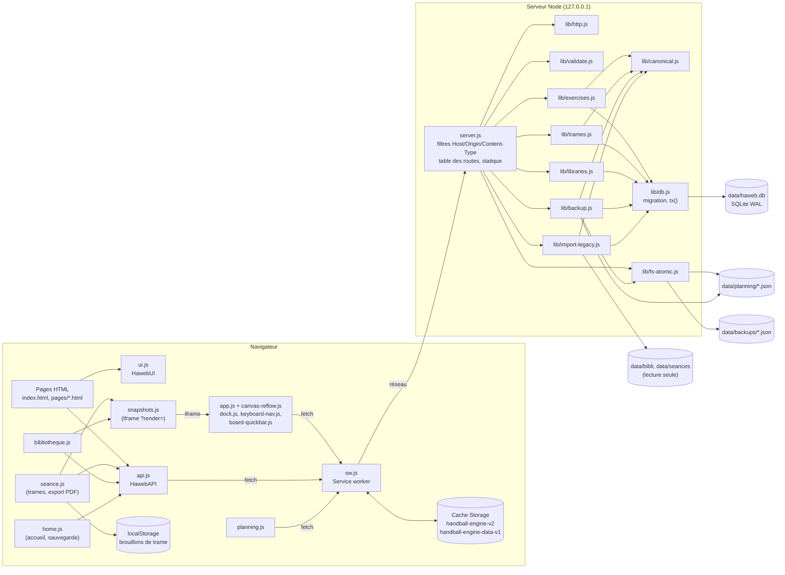
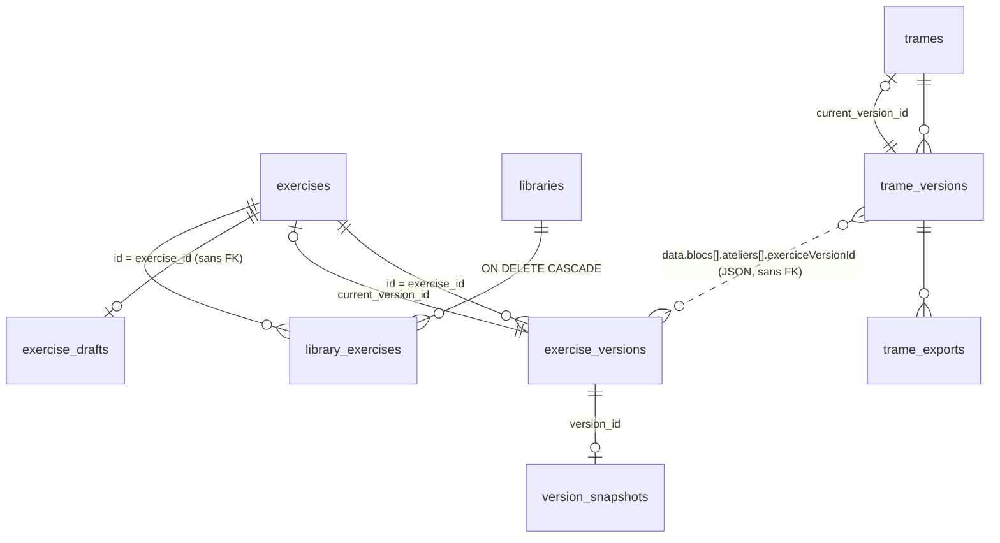

# Architecture technique — Handball Engine (web-board)

Branche analysée : `feat/bibliotheques-trames-historique` (commit `3a1db66`).
Les chemins sont relatifs à `web-board/` ; ceux qui commencent par `../tests/` ou `../` désignent le dépôt parent `haweb/`.
Une affirmation qui n'a pas pu être vérifiée dans le code est marquée « non vérifié ».

---

## 1. Vue d'ensemble

Handball Engine est une application **locale, mono-utilisateur** : un serveur Node.js sans framework sert à la fois les pages statiques et une API JSON, sur la boucle locale seulement.

- Serveur HTTP natif `http.createServer` (server.js:1, server.js:312) ; aucune dépendance npm dans `web-board/` (pas de `package.json` à cet endroit ; le seul `package.json` est `../package.json`, qui ne déclare que `@playwright/test` en devDependency, ../package.json:10-12).
- Persistance principale : SQLite via le module intégré `node:sqlite` (`DatabaseSync`, lib/db.js:5, lib/db.js:17). Fichier `data/haweb.db` (lib/config.js:17).
- Le planning reste stocké en fichiers JSON, un fichier par événement (server.js:63-71, server.js:198).
- Front-end : pages HTML + scripts classiques (pas de bundler, pas de module ES) qui exposent de petites API globales `window.Haweb*` (src/js/api.js:65, src/js/ui.js:115, src/js/snapshots.js:47, src/js/app.js:2602).
- PWA : manifeste (manifest.json:1-17) et service worker (sw.js:1-127) pour la consultation hors ligne.
- Port 3000 par défaut, surchargeable par `HAWEB_PORT` ; dossier de données surchargeable par `HAWEB_DATA_DIR` (lib/config.js:5-12).

### Schéma des composants



---

## 2. Modules et responsabilités

### 2.1 Serveur

| Module | Responsabilité | Références |
|---|---|---|
| `server.js` | Démarrage (création du dossier planning, nettoyage des `.tmp`, import des anciens JSON) ; en-têtes de sécurité ; filtres Host/Origin/Content-Type ; table de routes `[méthode, regex, handler]` ; service statique en liste blanche ; arrêt propre ; ouverture du navigateur. | server.js:23-25, 38-48, 74-246, 248-268, 276-310, 312-346, 348-359, 364-379 |
| `lib/config.js` | Chemins (`DATA_DIR`, `PLANNING_DIR`, `BACKUP_DIR`, `DB_PATH`…) et port. | lib/config.js:5-18 |
| `lib/http.js` | `sendJson`, `sendError` (corps `{error, field?}`), `HttpError`, lecture du corps JSON avec limite (413 au-delà), `isLocalRequest`. | lib/http.js:4-13, 15-21, 24-45, 47-50 |
| `lib/db.js` | Ouverture SQLite, PRAGMA (WAL, `synchronous=FULL`, clés étrangères, `busy_timeout`), transaction réentrante `tx()` en `BEGIN IMMEDIATE`, migration de schéma vers la version 2 avec copie de sécurité préalable. | lib/db.js:17-23, 27-41, 50-62, 73-181 |
| `lib/canonical.js` | JSON canonique (clés triées récursivement), `sha256`, `contentHash` qui ignore `updatedAt`, `exportedAt`, `snapshot`. | lib/canonical.js:5-17, 19, 26-30 |
| `lib/validate.js` | Validation des exercices, noms de bibliothèque, trames ; regex d'identifiant `^[a-zA-Z0-9_-]{1,64}$`. | lib/validate.js:4-9, 15-39, 41-46, 55-89 |
| `lib/exercises.js` | Versions d'exercice immuables et dédoublonnées par hash, brouillons, suppression logique, catalogue, restauration, vignettes de schéma. | lib/exercises.js:45-73, 100-102, 132-145, 148-166, 169-187, 192-214 |
| `lib/libraries.js` | Bibliothèques = étiquettes N–N sur les exercices (pas de copie) ; unicité du nom insensible à la casse. | lib/libraries.js:2, 31-37, 45-89 |
| `lib/trames.js` | Trames versionnées, résolution des versions d'exercice citées, durée totale calculée, exports HTML archivés. | lib/trames.js:34-54, 82-113, 128-143, 157-182 |
| `lib/backup.js` | Sauvegarde complète JSON (toutes les tables + planning), copie locale tournante (20), vérification d'intégrité, restauration transactionnelle. | lib/backup.js:13-27, 44-51, 59-66, 78-128, 151-192 |
| `lib/import-legacy.js` | Import idempotent des anciens fichiers `data/bibli/*.json` et `data/seances/*.json` (lecture seule, journal `import_log`), création de la bibliothèque « Mes exercices ». | lib/import-legacy.js:2-3, 24-52, 54-70 |
| `lib/fs-atomic.js` | Écriture atomique (tmp + fsync + rename + fsync du dossier), nettoyage des `.tmp` orphelins. | lib/fs-atomic.js:6-22, 25-30 |
| `scripts/export-legacy-json.js` | Retour arrière : réécrit la version courante de chaque exercice au format JSON historique. | scripts/export-legacy-json.js:2-3 |
| `scripts/verify-import.js` | Vérifie en lecture seule que chaque fichier de `data/bibli` est importé à l'identique. | scripts/verify-import.js:2-3 |
| `scripts/migrate-thematique.js` | Migration ponctuelle ajoutant `thematique` aux anciens fichiers `data/bibli/*.json`. | scripts/migrate-thematique.js:2-6 |
| `start.sh`, `launcher.sh` | Lancement ; libèrent le port 3000 (`fuser -k` / `kill -9` des PID trouvés par `lsof`). | start.sh:3, launcher.sh:20-35 |

### 2.2 Client

| Module | Responsabilité | Références |
|---|---|---|
| `src/js/api.js` | Client `api(method, path, body)` : pose `Content-Type: application/json` quand il y a un corps, lève `{status, message, field}` sur erreur, `{offline:true}` sans serveur ; bannière hors ligne, désactivation des boutons `[data-write]`, sondage `/api/health` toutes les 10 s. | src/js/api.js:9-35, 37-63 |
| `src/js/ui.js` | Toast, dialogue de confirmation, navigation commune (6 entrées), `escapeHtml`. | src/js/ui.js:5-12, 115 |
| `src/js/app.js` | Board tactique (canvas) : dessin, sauvegarde explicite = nouvelle version, brouillon automatique côté serveur (debounce 1,5 s), capture JPEG du schéma, mode rendu `?render=<versionId>`. | src/js/app.js:1555-1571, 1575-1604, 1608-1621, 1623-1641, 1644-1659, 2607-2637 |
| `src/js/canvas-reflow.js` | Redimensionne le canvas (resize avec debounce 100 ms, media queries, MutationObserver sur la sidebar) et émet `canvasReflowed`. | src/js/canvas-reflow.js:96-110, 121-126, 161-181, 186-199 |
| `src/js/dock.js` | Dock d'icônes et panneaux du board ; dépend des globales de `app.js` (ordre des scripts). API `window.DockAPI`. | src/js/dock.js:1-7, 33-40, 652-661 |
| `src/js/keyboard-nav.js` | Échap, Tab, flèches ; `window.KeyboardNavAPI`. | src/js/keyboard-nav.js:1-2, 341 |
| `src/js/board-quickbar.js` | Barre rapide clavier/tactile, s'appuie sur `window.HawebBoard`. | src/js/board-quickbar.js:1-2, src/js/app.js:2602 |
| `src/js/bibliotheque.js` | Page Bibliothèques : CRUD, filtres, détail, historique et restauration de versions. | src/js/bibliotheque.js:1, 33, 95-136, 218-363 |
| `src/js/seance.js` | Éditeur de trame (blocs, entrées à version figée), brouillon `localStorage`, enregistrement, historique, export PDF archivé. | src/js/seance.js:1, 20, 161-172, 205-216, 438-461, 659-673, 684-744 |
| `src/js/snapshots.js` | Garantit une vignette pour chaque version : rend la version dans une iframe cachée `board.html?render=…` et attend un `postMessage` (timeout 10 s). | src/js/snapshots.js:6, 8-32, 35-45 |
| `src/js/home.js` | Accueil « reprise rapide » (`/api/recent`) ; restauration d'une sauvegarde. | src/js/home.js:1, 18, 47-65 |
| `src/js/planning.js` | Calendrier ; utilise `fetch` direct, pas `api.js`. | src/js/planning.js:36, 47, 306-310, 327 |
| `src/js/pwa.js` | Enregistre `/sw.js` au `load`. | src/js/pwa.js:2-8 |
| `pages/explanation.html` | Fiche d'exercice ; réenregistre seule l'exercice (délai 1,2 s) avec ses notes et son explication, par `POST /api/exercises`. | pages/explanation.html:565-586 |

Chargement des scripts par page (vérifié par les balises `<script src>`) : `index.html` → pwa, ui, api, home ; `bibliotheque.html` → pwa, ui, api, snapshots, bibliotheque ; `seance.html` → pwa, ui, api, snapshots, seance ; `board.html` → pwa, app, canvas-reflow, dock, keyboard-nav, ui, board-quickbar ; `planning.html` → pwa, ui, planning. La page board ne charge **pas** `api.js`.

---

## 3. Modèle de données

### 3.1 Tables SQLite (schéma version 2)

`SCHEMA_VERSION = 2` (lib/db.js:9), stocké dans `schema_meta` (lib/db.js:78, 176).

| Table | Colonnes clés | Rôle | Références |
|---|---|---|---|
| `exercise_versions` | `version_id` PK autoincrément, `exercise_id`, `version_no`, `saved_at`, `name`, `data` (JSON texte), `content_hash`, `source` (`save`/`import`/`restore`), `restored_from`, `thematique`, `duree` | Versions immuables d'un exercice ; colonnes dénormalisées pour le catalogue. Index unique `(exercise_id, version_no)`. | lib/db.js:79-90, 174-175 |
| `exercises` | `id` PK, `created_at`, `current_version_id` → `exercise_versions`, `deleted_at` | Tête de l'exercice ; suppression logique. | lib/db.js:92-97 |
| `version_snapshots` | `version_id` PK → `exercise_versions`, `image` (data URL), `origin` (`embedded`/`rendered`), `generated_at` | Vignette de schéma par version. | lib/db.js:98-103 |
| `exercise_drafts` | `exercise_id` PK, `saved_at`, `data` | Brouillon non versionné (un par exercice). | lib/db.js:104-108 |
| `libraries` | `id` PK, `name` UNIQUE `COLLATE NOCASE`, `created_at`, `updated_at` | Bibliothèques. | lib/db.js:109-114 |
| `library_exercises` | PK `(library_id, exercise_id)`, `library_id` → `libraries` `ON DELETE CASCADE`, `exercise_id` → `exercises` | Lien N–N. | lib/db.js:115-120 |
| `trames` | `id` PK, `created_at`, `current_version_id` → `trame_versions`, `deleted_at` | Tête de trame. | lib/db.js:121-126 |
| `trame_versions` | `version_id` PK, `trame_id` → `trames`, `version_no`, `saved_at`, `titre`, `content_hash`, `data`, `source` ; UNIQUE `(trame_id, version_no)` | Versions immuables de trame. | lib/db.js:127-137 |
| `trame_exports` | `export_id` PK, `trame_id`, `trame_version_id`, `trame_version_no`, `exported_at`, `html`, `html_hash` | Archive HTML de chaque export PDF. | lib/db.js:138-146 |
| `import_log` | PK `(source_path, sha256)`, `status`, `target_id`, `version_id`, `error` | Journal d'import idempotent. | lib/db.js:147-156 |



Remarques vérifiées :
- `exercise_versions.exercise_id` n'a pas de clé étrangère déclarée (lib/db.js:79-85) ; `exercise_drafts` non plus (lib/db.js:104-108).
- Le lien trame → version d'exercice vit dans le JSON de la trame (`exerciceVersionId`), pas dans une table ; il est contrôlé à la validation (lib/validate.js:77-79) et à la restauration (lib/backup.js:109-115).

### 3.2 Versions

- **Dédoublonnage par contenu** : un enregistrement dont le hash canonique égale celui de la version courante ne crée rien et renvoie `created:false` (lib/exercises.js:50-59 ; lib/trames.js:38-44). Le hash d'exercice ignore `updatedAt`, `exportedAt`, `snapshot` (lib/canonical.js:19) ; celui de trame ignore `updatedAt` (lib/trames.js:7).
- **Numérotation** : `version_no = MAX(version_no)+1` par exercice / trame, dans la même transaction (lib/exercises.js:60 ; lib/trames.js:47).
- **Restauration** : crée une nouvelle version `source='restore'`, `restored_from=<id source>`, et recopie la vignette ; rien n'est effacé (lib/exercises.js:168-187). Restaurer la version déjà courante ne crée rien (lib/exercises.js:176-178).
- **Brouillon** : `PUT …/draft` écrit dans `exercise_drafts` sans créer de version (lib/exercises.js:132-136) ; il est supprimé à l'enregistrement suivant (lib/exercises.js:56, 70). Le client restaure un brouillon s'il est plus récent que la version chargée (src/js/app.js:1717-1728).
- **Page Explication** : elle n'utilise pas de brouillon ; elle enregistre seule 1,2 s après chaque modification par `POST /api/exercises` et crée donc une nouvelle version à chaque changement de contenu (pages/explanation.html:566, 578-584).
- **Suppression logique** : `deleted_at` renseigné, versions conservées (lib/exercises.js:24, 100-102 ; lib/trames.js:22, 151-153). Un réenregistrement « save » identique annule la suppression (lib/exercises.js:54-55 ; lib/trames.js:42).
- **Non-réutilisation des identifiants** après restauration : `sqlite_sequence` est remonté au maximum présent (lib/backup.js:168-174).

### 3.3 Snapshots (vignettes de schéma)

- Origine `embedded` : la data URL `snapshot` envoyée avec l'exercice est copiée dans `version_snapshots` (lib/exercises.js:67-69). Le board l'envoie à chaque « Enregistrer » (src/js/app.js:1639, 1649).
- Origine `rendered` : produite après coup par l'iframe `?render=` puis `PUT /api/versions/:vid/snapshot` (src/js/app.js:2607-2636 ; lib/exercises.js:192-204).
- Seuls JPEG et PNG sont acceptés et servis ; 900 Ko maximum ; une vignette `embedded` ne peut pas être remplacée (409) (lib/exercises.js:189-204, 210-211).
- Servies avec `Cache-Control: public, max-age=31536000, immutable` (server.js:101) et en cache d'abord côté service worker (sw.js:123).

### 3.4 Fichiers hors base

- `data/planning/<id>.json` : un fichier par événement, écrit atomiquement (server.js:195-200 ; lib/fs-atomic.js:6-22).
- `data/backups/` : copies de sauvegarde (20 conservées) et copie `avant-restauration-*` (lib/backup.js:59-66, 157).
- `data/haweb.db.bak-schema1-*` et `data/bibli.bak-import-*` : copies avant migration (lib/db.js:50-62).
- `data/bibli/`, `data/seances/` : anciens JSON, uniquement lus (lib/import-legacy.js:2-3).
- `localStorage` côté client : brouillon de trame `haweb-trame-draft-<id>` (src/js/seance.js:20, 163), données d'explication `handball-explanation-data` (src/js/app.js:2588 ; pages/explanation.html:571), ancienne bibliothèque `handball-library` migrée puis supprimée (src/js/app.js:1663-1676).

---

## 4. Flux principaux

### 4.1 Création d'un exercice

```mermaid
sequenceDiagram
  participant B as Board (app.js)
  participant S as server.js
  participant V as validate.js
  participant E as exercises.js
  participant D as SQLite
  B->>B: saveToBibli() : id = 'ex_'+Date.now() si absent
  B->>B: buildExerciseData(true) + captureSchema() JPEG 0.9
  B->>S: POST /api/exercises (JSON)
  S->>V: validateExercise()
  alt invalide
    S-->>B: 400 {error, field}
  else valide
    S->>E: saveExercise(data)
    E->>D: BEGIN IMMEDIATE ; hash identique ? → created:false
    E->>D: INSERT exercise_versions, INSERT/UPDATE exercises, INSERT version_snapshots (embedded), DELETE draft ; COMMIT
    S-->>B: 200 {success, created, versionId, versionNo}
  end
```

Références : src/js/app.js:1575-1604, 1608-1641, 1644-1659 ; server.js:79-85 ; lib/validate.js:15-39 ; lib/exercises.js:45-73. Contraintes : nom 1–100 caractères, `thematique` ∈ {attaque, defense, gardien, enclenchement}, `duree` entier 1–180, `notes` ≤ 2000, `items`/`paths` ≤ 300 éléments (lib/validate.js:5, 11-13, 18-34).

### 4.2 Versionnage et historique

- Liste : `GET /api/exercises/:id/versions` (server.js:91 ; lib/exercises.js:104-113).
- Lecture d'une version : `GET /api/exercises/versions/:vid` (server.js:86-90 ; lib/exercises.js:119-130).
- Restauration : `POST /api/exercises/:id/restore {versionId}` (server.js:92-97 ; lib/exercises.js:169-187), appelée depuis la page Bibliothèques (src/js/bibliotheque.js:350).
- Trames : même principe (`GET /api/seances/:id/versions`, `GET /api/seances/versions/:vid`) (server.js:164-169 ; lib/trames.js:121-125, 145-149). Pas de route de restauration de trame (absente de la table server.js:74-246).

### 4.3 Bibliothèque

- Une bibliothèque est une étiquette ; ajouter un exercice crée un lien, sans copie (lib/libraries.js:2, 72-81). `INSERT OR IGNORE` rend l'ajout idempotent (lib/libraries.js:19).
- Supprimer une bibliothèque supprime ses liens par cascade et ne touche aucun exercice (lib/libraries.js:63-70 ; lib/db.js:116).
- Le compteur ignore les exercices supprimés logiquement (lib/libraries.js:9-12).
- Le catalogue (`GET /api/catalog`) renvoie la version courante de chaque exercice avec `libraryIds` et `hasSnapshot` (lib/exercises.js:28-32, 148-166).
- À l'import initial, si des exercices sont créés et qu'aucune bibliothèque n'existe, « Mes exercices » est créée et les reçoit (lib/import-legacy.js:13, 57-68).

### 4.4 Trame

- Une entrée de bloc fige `exerciceId` + `exerciceVersionId` de la version courante au moment de l'ajout, avec `dureeOverride` (src/js/seance.js:205-211).
- Validation : titre 1–120, date `YYYY-MM-DD` réelle, ≤ 20 blocs, ≤ 12 entrées par bloc, la version citée doit appartenir à l'exercice cité, `dureeTotal` refusé car calculé (lib/validate.js:55-89).
- La lecture renvoie la trame et un dictionnaire `exerciseVersions` résolu (nom, description, matériel, durée, `hasSnapshot`, `isLatest`) (lib/trames.js:82-113). Le client affiche un badge si une version plus récente existe (src/js/seance.js:245-250).
- Durée effective : `dureeOverride` ?? durée de la version ?? ancien champ `duree` (lib/trames.js:128-135).
- Brouillon local : chaque modification écrit la trame dans `localStorage` (src/js/seance.js:161-163) ; une bannière propose de reprendre un brouillon différent de la version serveur (src/js/seance.js:145, 156, 472-487) ; il est effacé à l'enregistrement (src/js/seance.js:444).

### 4.5 Export PDF et archive

```mermaid
sequenceDiagram
  participant T as seance.js
  participant S as server.js / trames.js
  participant N as snapshots.js
  participant I as iframe board.html?render=vid
  T->>S: POST /api/seances (si modifiée ou jamais enregistrée)
  T->>T: exportBlocker() : titre, ≥1 exercice, durées, ≤4 exercices par bloc
  T->>S: GET /api/seances/versions/:vid (trame résolue)
  T->>N: ensure(versions sans vignette)
  N->>I: charge la version, rend, capture
  I->>S: PUT /api/versions/:vid/snapshot
  I-->>N: postMessage {type:'haweb-snapshot', ok}
  T->>T: buildDocument() puis findTallBloc() (> 1000 px bloque)
  T->>T: buildArchive() : HTML autonome, CSS inline, images en data URL
  T->>S: POST /api/seances/:id/exports {trameVersionId, html}
  S->>S: vérifie <!DOCTYPE html>, ≤ 20 Mo, version ∈ trame ; INSERT trame_exports (+ sha256)
  T->>T: window.print() → « Enregistrer au format PDF »
```

Références : src/js/seance.js:703-744, 684-701, 659-673, 746-754 ; src/js/snapshots.js:8-45 ; src/js/app.js:2607-2637 ; server.js:170-174 ; lib/trames.js:155-171.

- Le PDF lui-même est produit par la boîte d'impression du navigateur (src/js/seance.js:737-738) ; le serveur archive le **HTML**, pas un fichier PDF.
- Consultation d'une archive : `GET /api/exports/:exportId`, servie avec une CSP restrictive `default-src 'none'; img-src data:; style-src 'unsafe-inline'` (server.js:176-182). Ce chemin est exclu du service worker (sw.js:122).
- Liste : `GET /api/seances/:id/exports` (server.js:175 ; lib/trames.js:173-178).

### 4.6 Sauvegarde et restauration

- **Sauvegarde** : `GET /api/backup` (lien `index.html:46`) sérialise toutes les tables dans l'ordre de leur clé primaire plus le planning, avec `format: 'handball-engine-backup'`, `formatVersion: 1`, `schemaVersion` (lib/backup.js:13-24, 29, 44-51). Une copie est écrite atomiquement dans `data/backups/` ; seules les 20 plus récentes sont gardées (lib/backup.js:59-66). Réponse en pièce jointe `handball-engine-sauvegarde-AAAA-MM-JJ.json` (server.js:222-232 ; lib/backup.js:53-56).
- **Restauration** : `POST /api/restore` (corps ≤ 200 Mo, server.js:21, 233-237), déclenchée depuis l'accueil après confirmation (src/js/home.js:47-65). Étapes (lib/backup.js:151-192) :
  1. `verify()` : format, présence de chaque section, bornes des identifiants (1 à 2147483647), hash de chaque version d'exercice et de trame recalculé, références (version courante, vignettes, liens bibliothèque, versions citées par les trames, exports et leur `html_hash`), id de planning valides (lib/backup.js:72-128). Échec → 400 « Rien n'a été modifié » (lib/backup.js:68-70).
  2. `checkSnapshotImages()` : toute vignette non JPEG/PNG → 422 avec la liste des exercices (lib/backup.js:131-149).
  3. Copie de l'état courant `avant-restauration-<horodatage>.json` (lib/backup.js:156-157).
  4. Une transaction : `defer_foreign_keys`, vidage enfants d'abord, réinsertion dans l'ordre inverse, recalage de `sqlite_sequence` (lib/backup.js:159-175).
  5. Planning : écriture dans un dossier temporaire puis échange de dossiers ; l'ancien est renommé `planning.old-<horodatage>` (lib/backup.js:177-183).
- Sauvegarde, restauration et arrêt n'acceptent que la boucle locale (`isLocalRequest`) (server.js:223, 234, 241 ; lib/http.js:47-50).

### 4.7 Mode hors ligne (PWA)

Stratégies du service worker (sw.js:1-5, 118-127) :

| Requête | Stratégie | Références |
|---|---|---|
| Pages, CSS, JS, images (même origine) | Cache d'abord + mise à jour en arrière-plan (stale-while-revalidate), cache `handball-engine-v2` préchargé avec l'app shell | sw.js:6, 8-51, 53-57, 106-116, 126 |
| `GET /api/*` | Réseau d'abord ; repli sur la dernière réponse connue marquée `x-haweb-cache: 1` ; sinon 503 `x-haweb-offline: 1` | sw.js:67-91, 124 |
| `GET /api/versions/:vid/snapshot` | Cache d'abord (images immuables) | sw.js:93-104, 123 |
| `GET /api/backup`, `GET /api/exports/*` | Non interceptés | sw.js:122 |
| `POST`/`PUT`/`PATCH`/`DELETE`, autres origines | Non interceptés | sw.js:120 |

Côté pages qui chargent `api.js` : une réponse marquée `x-haweb-cache` ou 503 hors ligne active la bannière et désactive les boutons `[data-write]` ; un sondage de `/api/health` toutes les 10 s la retire au retour du serveur (src/js/api.js:9-35, 49-55). La trame peut être préparée hors ligne grâce au brouillon `localStorage`, puis enregistrée au retour (src/js/seance.js:161-163 ; scénario testé par ../tests/e2e/offline.spec.js:8-37). L'activation supprime les anciens caches dont le nom diffère (sw.js:59-65).

---

## 5. Contrats d'API

Format d'erreur commun : `{ "error": "<message>", "field": "<champ>"? }` (lib/http.js:9-13). Erreur non prévue → 500 `Erreur serveur` (server.js:259-262). Route inconnue → 404 `Route inconnue` (server.js:266). Corps JSON illisible → 400 (lib/http.js:37-41). Corps trop gros → 413 et `Connection: close` (lib/http.js:31-35 ; server.js:257). Identifiant texte invalide → 400 `field:'id'` (server.js:50-55) ; identifiant numérique non entier positif → 404 (server.js:57-61).

Limites de corps : 1 Mo par défaut, 20 Mo pour un export, 200 Mo pour une restauration (server.js:19-21).

| Méthode | Route | Corps / réponse | Codes | Réf. |
|---|---|---|---|---|
| GET | `/api/health` | `{ok:true, schemaVersion}` | 200 | server.js:75 |
| GET | `/api/exercises` | données courantes de chaque exercice non supprimé | 200 | server.js:78 ; lib/exercises.js:81-83 |
| POST | `/api/exercises` | exercice → `{success, created, versionId, versionNo}` | 200, 400 | server.js:79-85 |
| GET | `/api/exercises/versions/:vid` | `{versionId, versionNo, exerciseId, savedAt, name, data}` | 200, 404 | server.js:86-90 |
| GET | `/api/exercises/:id/versions` | liste des versions (n° décroissant) | 200, 400 | server.js:91 |
| POST | `/api/exercises/:id/restore` | `{versionId}` → `{created, versionId, versionNo, message?}` | 200, 400, 404 | server.js:92-97 ; lib/exercises.js:172 |
| GET | `/api/versions/:vid/snapshot` | image binaire JPEG/PNG | 200, 404 | server.js:98-103 |
| PUT | `/api/versions/:vid/snapshot` | `{image}` → `{ok:true}` | 200, 400, 404, 409 | server.js:104-108 ; lib/exercises.js:192-204 |
| GET | `/api/exercises/:id/draft` | `{savedAt, data}` | 200, 404 | server.js:109-113 |
| PUT | `/api/exercises/:id/draft` | objet → `{success, savedAt}` | 200, 400 | server.js:114-119 |
| DELETE | `/api/exercises/:id/draft` | `{success}` | 200, 400 | server.js:120-123 |
| GET | `/api/exercises/:id` | données courantes | 200, 400, 404 | server.js:124-128 |
| DELETE | `/api/exercises/:id` | suppression logique → `{success}` (200 même si inexistant) | 200, 400 | server.js:129-132 ; lib/exercises.js:100-102 |
| GET | `/api/catalog` | catalogue léger | 200 | server.js:135 |
| GET | `/api/libraries` | `[{id, name, count, updatedAt}]` | 200 | server.js:136 |
| POST | `/api/libraries` | `{name}` → `{id, name}` | 201, 400, 409 | server.js:137-140 ; lib/libraries.js:31-37 |
| PATCH | `/api/libraries/:id` | `{name}` → `{id, name}` | 200, 400, 404, 409 | server.js:141-144 |
| DELETE | `/api/libraries/:id` | `{success}` | 200, 404 | server.js:145 |
| POST | `/api/libraries/:id/exercises` | `{exerciseId}` → `{success}` | 200, 400, 404 | server.js:146-151 ; lib/libraries.js:72-81 |
| DELETE | `/api/libraries/:id/exercises/:exId` | `{success}` | 200, 400, 404 | server.js:152-153 |
| GET | `/api/seances` | données courantes des trames | 200 | server.js:156 |
| POST | `/api/seances` | trame → `{success, created, versionId, versionNo}` | 200, 400 | server.js:157-163 |
| GET | `/api/seances/versions/:vid` | `{trameId, trame, versionId, versionNo, savedAt, exerciseVersions}` | 200, 404 | server.js:164-168 |
| GET | `/api/seances/:id/versions` | liste des versions | 200, 400 | server.js:169 |
| POST | `/api/seances/:id/exports` | `{trameVersionId, html}` → `{exportId, exportedAt, trameVersionNo}` | 200, 400, 413 | server.js:170-174 ; lib/trames.js:157-171 |
| GET | `/api/seances/:id/exports` | liste des exports | 200, 400 | server.js:175 |
| GET | `/api/exports/:exportId` | HTML archivé, CSP stricte | 200, 404 | server.js:176-182 |
| GET | `/api/seances/:id` | trame résolue courante | 200, 400, 404 | server.js:183-187 |
| DELETE | `/api/seances/:id` | suppression logique → `{success}` | 200, 400 | server.js:188-191 |
| GET | `/api/planning` | événements (fichiers lus) | 200 | server.js:194 |
| POST | `/api/planning` | événement avec `id` valide → `{success}` | 200, 400 | server.js:195-200 |
| DELETE | `/api/planning/:id` | `{success}` | 200, 400 | server.js:201-205 |
| GET | `/api/recent` | `{libraries (6), trames (5, avec durée), exercises (5)}` | 200 | server.js:208-219 |
| GET | `/api/backup` | sauvegarde JSON en pièce jointe | 200, 403 | server.js:222-232 |
| POST | `/api/restore` | sauvegarde → `{ok, counts}` | 200, 400, 403, 413, 422 | server.js:233-237 ; lib/backup.js:79-80, 147 |
| POST | `/api/shutdown` | `{ok:true}` puis `process.exit(0)` après 200 ms | 200, 403 | server.js:240-245 |

Codes renvoyés avant le routage, pour toute requête : 403 `Hôte non autorisé`, 403 `Origine non autorisée`, 415 `Type de contenu JSON requis`, 204 pour `OPTIONS` (server.js:323-341). La route `/api/seances` garde son nom historique bien qu'elle gère les trames (server.js:155).

---

## 6. Sécurité

| Contrôle | Détail | Références |
|---|---|---|
| Écoute locale uniquement | `server.listen(PORT, HAWEB_HOST || '127.0.0.1')` ; commentaire interdisant `0.0.0.0` sans authentification. | server.js:361-365 |
| Contrôle Host | Seuls `localhost:PORT`, `127.0.0.1:PORT`, `[::1]:PORT` sont acceptés, sinon 403 (protège du DNS rebinding). | server.js:323-327 |
| Contrôle Origin | Si l'en-tête `Origin` est présent, il doit valoir `http://` + un des hôtes locaux, sinon 403. | server.js:328-332 |
| Content-Type | `POST` et `PUT` exigent `application/json`, sinon 415 : un formulaire cross-site ne peut pas écrire, et un `fetch` JSON cross-site déclenche un préflight refusé par le contrôle Origin. | server.js:320-322, 333-336 |
| Pas de CORS | Aucun en-tête `Access-Control-Allow-*`. | server.js:313-317 |
| En-têtes | `nosniff`, `X-Frame-Options: SAMEORIGIN`, `Referrer-Policy: no-referrer`, CSP `default-src 'self'` (avec `'unsafe-inline'` pour scripts et styles, polices Google, `img-src 'self' data:`, `frame-ancestors 'self'`). | server.js:38-48, 43 |
| Liste blanche statique | Seuls `/`, `/index.html`, `/manifest.json`, `/sw.js` et les préfixes `/pages/`, `/src/`, `/assets/` sont servis, après décodage et normalisation ; liste noire supplémentaire (`/data/`, `/lib/`, `/scripts/`, `/.omc/`, `/.git/`, `*.db`, `*-wal`, `*-shm`) ; vérification finale que le chemin reste sous `APP_DIR`. | server.js:270-298 |
| Identifiants | Regex stricte `^[a-zA-Z0-9_-]{1,64}$` pour tout id texte ; empêche la traversée dans `data/planning/<id>.json`. | lib/validate.js:4-9 ; server.js:50-55, 197-202 |
| Opérations sensibles | Sauvegarde, restauration, arrêt : adresse distante de boucle locale exigée en plus. | server.js:223, 234, 241 ; lib/http.js:47-50 |
| Images | Vignettes limitées à JPEG/PNG en data URL (jamais de SVG servi) ; même règle à la restauration. | lib/validate.js:35-37 ; lib/exercises.js:189-213 ; lib/backup.js:131-149 |
| Archives d'export | Servies sous CSP `default-src 'none'` : aucun script exécutable. | server.js:179 |
| SQL | Requêtes préparées avec paramètres pour les valeurs ; les noms de tables interpolés proviennent de constantes internes. | lib/exercises.js:7-33 ; lib/backup.js:13-24, 47, 161-166 |
| Échappement HTML côté client | `escapeHtml` utilisé dans le document de trame. | src/js/ui.js:115 ; src/js/seance.js:641-647, 668 |

---

## 7. Tests

Les tests sont dans le dépôt parent `haweb/tests/` (pas de dossier `web-board/tests`). Scripts : `npm run test:api` (runner `node --test`, en série) et `npm run test:e2e` (Playwright, Chromium, un seul worker, serveur sur le port 3100 avec données isolées dans `tests/.tmp/e2e-data`) (../package.json:5-8 ; ../playwright.config.js:7-24). Les tests API démarrent un serveur sur un dossier temporaire garni des fixtures, jamais `web-board/data` (../tests/helpers/server.js:3, 10-13, 37-40).

Exécution vérifiée pendant cette rédaction : `node --test --test-concurrency=1 tests/api/*.test.js` → **52 tests, 52 réussis, 0 échec** (durée ≈ 55 s), relancé le 2026-11-06 sur l'arbre de travail (`../tests/api/security.test.js` modifié, non commité au commit 3a1db66). Les tests E2E n'ont pas été exécutés pendant cette rédaction (non vérifié).

| Fichier | Couverture |
|---|---|
| ../tests/api/atomicity.test.js:29, 62 | `SIGKILL` pendant les écritures : aucune version acquittée perdue ; fichiers de planning toujours JSON valides. |
| ../tests/api/backup.test.js:26-140 | Sauvegarde A → restauration B identique ; `isLocalRequest` ; pas de réutilisation d'id ; schéma non JPEG/PNG refusé ; id hors bornes refusé ; SVG refusé à l'enregistrement. |
| ../tests/api/exercises.test.js:24-81 | Création, validation de `thematique` et d'`id`, liste, suppression. |
| ../tests/api/exports.test.js:15, 37 | Export archivé relu à l'identique ; version d'une autre trame refusée ; document invalide refusé. |
| ../tests/api/libraries.test.js:26-73 | Exercice dans deux bibliothèques stocké une fois ; renommer, doublon 409, supprimer sans perte ; retrait isolé ; erreurs 400/404. |
| ../tests/api/planning.test.js:24-72 | Création, événement orphelin après suppression de séance, dates anciennes, suppression. |
| ../tests/api/seances.test.js:24-63 | Aller-retour d'une trame, refus de `dureeTotal`, suppression. |
| ../tests/api/security.test.js:12-100 | En-têtes de sécurité, traversée de chemin statique, id malveillant → 400, corps > 1 Mo → 413, query string ignorée, absence de CORS (l. 12-50) ; Host étranger → 403 (l. 66-69, via `http.request` car `fetch` ne force pas `Host`), Origin étrangère → 403 (l. 71-77), `text/plain` → 415 (l. 79-85), Origin locale acceptée (l. 87-93), liste blanche statique → 404 (l. 95-100). |
| ../tests/api/storage.test.js:31-111 | Import fidèle et idempotent, dédoublonnage par hash, validation, données non servies en statique, suppression logique, brouillon sans version. |
| ../tests/api/trames.test.js:16-57 | Version figée d'exercice dans la trame, refus de `dureeTotal`, validations, numérotation des versions. |
| ../tests/api/versions.test.js:17-45 | Restauration sans effacement, version d'un autre exercice → 404, vignettes (400, PUT, 409 sur `embedded`). |
| ../tests/e2e/*.spec.js (16 fichiers) | Accueil et reprise (accueil), bibliothèques, board (fin de trajectoire, barre rapide clavier/tactile), Dock (icônes, panneaux, reflow, accessibilité, performance), cohérence de navigation, guide imprimable, absence de défilement (1366×768, 1920×1080), lisibilité WCAG, hors ligne, planning, trame et séance (échappement HTML), export PDF archivé, historique de versions et génération de schéma manquant. Titres relevés dans chaque fichier, ex. ../tests/e2e/offline.spec.js:8, ../tests/e2e/trame-pdf.spec.js:32, ../tests/e2e/versions.spec.js:7. |

Les contrôles Host, Origin et Content-Type (server.js:323-336) sont couverts par ../tests/api/security.test.js:66-93. Trou restant : `PATCH` sans `Content-Type` (voir §9 point 2) n'est pas testé.

---

## 8. Décisions d'architecture

| Décision | Justification (telle qu'écrite dans le code) | Références |
|---|---|---|
| Serveur Node natif, sans dépendance d'exécution | Application locale ; seul Playwright est en devDependency. | server.js:1-5 ; ../package.json:10-12 |
| SQLite intégré (`node:sqlite`) en WAL + `synchronous=FULL` | Transactions et durabilité des versions acquittées (vérifiée par le test SIGKILL). | lib/db.js:5, 18-23 ; ../tests/api/atomicity.test.js:29 |
| Versions immuables, dédoublonnées par hash de JSON canonique | Ne jamais perdre une version ; un enregistrement identique ne crée rien (CA5). | lib/exercises.js:2, 43-59 ; lib/canonical.js:25-30 |
| Restauration = nouvelle version | « rien n'est effacé (CA6) ». | lib/exercises.js:168 |
| Bibliothèques = étiquettes N–N | « sans copie des exercices (CA1–CA3) ». | lib/libraries.js:2 |
| Trame qui fige la version d'exercice | Une trame garde la version exacte même si l'exercice évolue (CA10). | lib/trames.js:2 ; lib/validate.js:77-79 ; ../tests/api/trames.test.js:16 |
| Durée totale jamais stockée | Calculée, `dureeTotal` refusé à l'entrée (CA9). | lib/validate.js:58 ; lib/trames.js:137-143 |
| Côté Board : brouillon auto non versionné, seule l'action « Enregistrer » versionne. La page Explication fait exception : son enregistrement automatique crée une version à chaque modification | Q8 : éviter une version à chaque frappe (Board). | src/js/app.js:1554 ; lib/exercises.js:132-136 ; pages/explanation.html:566, 578-584 |
| Vignettes générées par le board lui-même dans une iframe | Un seul moteur de rendu ; `X-Frame-Options: SAMEORIGIN` choisi pour cela (S3). | src/js/snapshots.js:1-2 ; server.js:40-41 |
| Export archivé en HTML autonome, PDF via l'impression du navigateur | Archive relisible octet pour octet (CA16), sans bibliothèque PDF. | src/js/seance.js:659-673, 737-738 ; lib/trames.js:157-171 |
| Planning en fichiers JSON atomiques | Hérité ; écriture atomique tmp + fsync + rename (CA17). | lib/fs-atomic.js:2 ; server.js:63, 198 |
| Import des anciens JSON en lecture seule et idempotent | Fichiers sources « jamais écrits, renommés ni supprimés » ; journal par (chemin, sha256). | lib/import-legacy.js:2-3, 15, 31 |
| Copie de sécurité avant migration et avant restauration | Retour arrière possible. | lib/db.js:50-62 ; lib/backup.js:155-157 |
| Sécurité par isolement local plutôt qu'authentification | Écoute 127.0.0.1, Host/Origin/Content-Type, pas de CORS. | server.js:313-336, 361-365 |
| Service worker réseau d'abord pour l'API, écritures jamais interceptées | Consultation hors ligne sans risque d'écriture fantôme (S6). | sw.js:1-5, 120 |

---

## 9. Limites connues

Constatées dans le code (aucune n'a été corrigée ici) :

1. **Versions automatiques depuis la page Explication** : chaque modification enregistrée (délai 1,2 s) crée une version, contrairement au Board (pages/explanation.html:566, 578-584 ; voir §3.2). L'historique peut s'allonger vite. (Les contrôles Host/Origin/Content-Type, autrefois non testés, sont couverts, voir §7.)
2. **`PATCH` n'est pas soumis au contrôle Content-Type** : seuls `POST` et `PUT` le sont (server.js:333). `PATCH /api/libraries/:id` lit pourtant un corps JSON (server.js:141-144). Le risque reste limité car un `PATCH` cross-site impose un préflight, refusé par le contrôle Origin (server.js:328-332).
3. **`GET /api/backup` a un effet de bord** (écriture d'une copie et rotation, server.js:226 ; lib/backup.js:59-66). Une navigation de premier niveau depuis un autre site (sans en-tête Origin sur un GET) peut la déclencher ; elle ne permet pas de lire les données (non vérifié par test).
4. **Restauration non atomique entre base et planning** : la transaction SQLite est validée (lib/backup.js:159-175) avant l'échange des dossiers de planning (lib/backup.js:177-183). Un arrêt entre les deux laisse un état mixte. Les dossiers `planning.old-*` s'accumulent sans nettoyage (lib/backup.js:182).
5. **Le contenu d'un export n'est pas vérifié par le serveur** : il contrôle le préfixe `<!DOCTYPE html>`, la taille et l'appartenance de la version (lib/trames.js:158-166), pas la correspondance entre le HTML et la version citée.
6. **Vignettes `rendered` remplaçables malgré un cache `immutable`** : `INSERT OR REPLACE` n'est bloqué que pour `embedded` (lib/exercises.js:17, 199-201), alors que l'image est servie `immutable` (server.js:101) et en cache d'abord (sw.js:93-96).
7. **Planning sans validation de contenu** : seul `id` est contrôlé (server.js:197) ; pas de limite de champs ni de schéma.
8. **Pas de restauration de version de trame** côté API (aucune route, server.js:155-191).
9. **Board sans gestion hors ligne unifiée** : `board.html` ne charge pas `api.js` (balises `<script>` de pages/board.html) ; `app.js` utilise `fetch` direct, et l'échec d'un brouillon n'est signalé qu'en console (src/js/app.js:1561-1569). Idem pour `planning.js` (src/js/planning.js:306-310).
10. **Cache du service worker versionné à la main** (`handball-engine-v2`, sw.js:6) et stratégie stale-while-revalidate (sw.js:106-116) : une nouvelle version de l'application n'est visible qu'au chargement suivant, sauf changement du nom de cache.
11. **Couplage par globales dans le board** : `dock.js` dépend des globales de `app.js` et de l'ordre des scripts (src/js/dock.js:4-6) ; `app.js` fait 2 681 lignes.
12. **CSP avec `'unsafe-inline'`** pour les scripts et styles (server.js:43), nécessaire aux scripts inline des pages (ex. pages/explanation.html:570-585).
13. **Scripts de lancement brutaux** : `fuser -k 3000/tcp` et `kill -9` sur tout processus du port 3000 (start.sh:3 ; launcher.sh:23-30), indépendamment de `HAWEB_PORT`.
14. **Version de Node requise non déclarée** : `node:sqlite` exige une version récente de Node ; aucun champ `engines` n'a été trouvé. Tests exécutés ici avec Node v24.22.1. Version minimale : non vérifié.
15. **Identifiants d'exercice générés côté client** (`'ex_' + Date.now()`, src/js/app.js:1578-1580) : deux onglets peuvent en théorie produire le même id dans la même milliseconde (non vérifié en pratique).

---

## Résumé

1. Application locale : serveur Node natif (server.js) sur 127.0.0.1, SQLite intégré (lib/db.js), pages HTML et scripts classiques, PWA (sw.js).
2. Exercices et trames sont des versions immuables dédoublonnées par hash canonique ; une restauration crée une nouvelle version, une suppression est logique.
3. Les bibliothèques sont des étiquettes N–N ; une trame fige la version exacte de chaque exercice ; la durée totale est toujours calculée.
4. L'export PDF passe par l'impression du navigateur ; le serveur archive le HTML autonome (sha256) et le sert sous une CSP fermée.
5. La sécurité repose sur l'isolement local : contrôles Host, Origin, Content-Type, liste blanche statique, ids stricts, sauvegarde et restauration limitées à la boucle locale.
6. 52 tests API passent, dont Host/Origin/415 ; principaux manques : versions automatiques de la page Explication, restauration base/planning non atomique, board et planning hors du client `api.js`.
